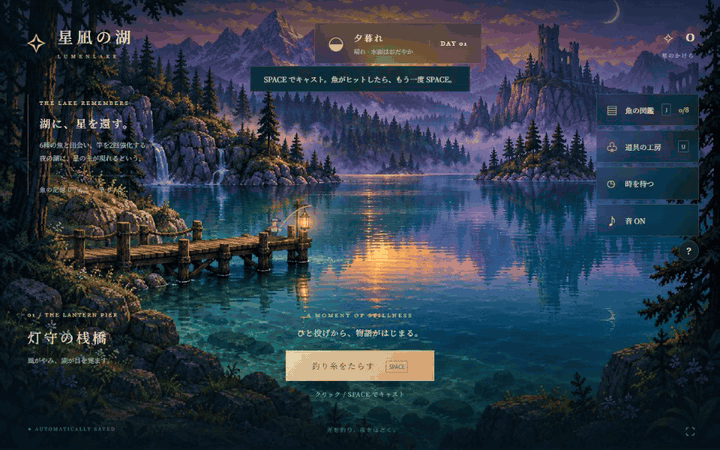

# 星凪の湖 — LUMENLAKE

**光を釣り、夜をほどく。**  
夕暮れの桟橋から、忘れられた星を探す小さな釣りの旅。青緑の湖、遠くの廃塔、雨音と灯り。魚たちの記憶を集めて、夜に現れる湖の主に会いに行きます。



▶ **[実プレイ動画（MP4・約40秒・無音）](docs/gameplay.mp4)**  
GIFは実行中のゲームをMicrosoft Edgeで操作し、DOMとCanvasをそのままキャプチャしたものです。静止画から作った架空のプレイ映像ではありません。キャスト、ヒット、リール操作、釣果を収録しています。長い動画には図鑑と夜の景色も含まれます。

## プレイする

**[ブラウザで今すぐプレイ（GitHub Pages）](https://onego15.github.io/fishing-gpt/)**

インストール不要で遊べます。以下はローカルで起動する場合の手順です。

Node.js 18以降を用意し、このフォルダーで実行してください。ゲーム自体の依存パッケージのインストールは不要です。

```sh
npm start
```

ブラウザで **http://127.0.0.1:4187** を開きます。終了はターミナルで `Ctrl+C`。

- HTML / CSS / JavaScriptと画像だけで動作する静的ゲームです。一般的な静的ホスティングでも配信できます。
- 別ポートを使う場合、PowerShellでは `$env:PORT=5000; npm start`。
- 保存はブラウザのlocalStorageに自動記録されます。端末・ブラウザ・接続元URLごとに別のセーブです。
- 外部フォントを取得できないときは端末の明朝体に切り替わります。ゲーム本体・背景・効果音は外部サービスを必要としません。
- ソースリポジトリ：[onego15/fishing-gpt](https://github.com/onego15/fishing-gpt)。`main`へのpushでGitHub Actionsがゲームに必要なファイルをGitHub Pagesへ自動公開します。

## 特徴

- **光と空気を描く2.5Dの湖**：ピクセル背景、独立した前景の揺れ、水面の屈折、光の反射、霧、蛍、雨、ランタンの光、ゆるやかなカメラの寄り。
- **魚ごとのリズム**：ゆったり泳ぐコハクブナ、急に切り返す雨詠みのナマズ、波を描く月灯りのウオなど、8種の魚。色・ひれ・模様・泳ぎ方・出現条件が異なります。
- **収集と成長**：魚の図鑑、最大サイズの記録、2段階の竿強化、失敗を緩和するお守り。
- **時間と天候**：夕暮れ→星月夜→夜明けが各3分で移り変わります。晴れ・雨で出会える魚も変化します。
- **短い物語**：6種の記憶と2回の竿強化を揃え、夜の「星凪の主・ルーメン」を釣るとエンディング。クリア後も遊べます。
- **静かな音**：Web Audioによるオリジナルの環境音楽と、キャスト・ヒット・釣果の音。最初の操作後に開始します。
- **手元にやさしく**：キーボード・マウス・タッチ対応、メニュー中と非表示タブでは進行を停止、自動保存。

自然に景色を眺めながら進める想定時間は**10〜15分**です。夜明けに6種を揃え、次の夜に主を探す流れを想定しています。「時を待つ」で時間を送ると大幅に短縮できます。実際の所要時間は釣果と操作に依存し、人による所要時間の計測は未実施です。

## 操作方法

| 操作 | キーボード | マウス・タッチ |
|---|---|---|
| キャスト | SPACE | 釣り糸をたらす |
| ヒットへの合わせ | HITから2.6秒以内にSPACE | 引き上げる |
| ミニゲーム | SPACE長押しで帯が右、離すと左 | リールボタン長押し／解放 |
| 図鑑 | J | 魚の図鑑 |
| 強化 | U | 道具の工房 |
| 時間・天気を進める | — | 時を待つ |
| 閉じる・釣りを中断 | ESC | × |
| 音のON/OFF | — | ♪ |
| 全画面 | — | 右下の⛶ |

ミニゲームでは、魚の **◆** を緑の光の帯に入れ続けましょう。ゲージが100%で成功、0%で逃げます。逃げても所持品を失いません。魚は湖へ還し、星のかけらと記憶を受け取ります。

竿は60→110かけらで強化。帯が広くなります。75かけらのお守りは帯の外にいる時の減少を30%軽減します。まず竿の強化がおすすめです。

## 使用技術・AI制作情報

| 項目 | 内容 |
|---|---|
| AIサービス名 | ChatGPT / Codex |
| 使用モデルの正式名称・バージョン | **未確認**。実行環境から正式なモデル識別子を確認できないため推測しません。 |
| ゲームエンジン・フレームワーク | 独自のCanvas 2D描画・ゲームループ。外部ゲームエンジンなし |
| 使用言語 | JavaScript、HTML、CSS。検証・エンコード補助にPython |
| 描画 | Canvas 2D、DOM UI、CSS、requestAnimationFrame |
| 音 | Web Audio APIによる合成音 |
| 保存 | localStorage |
| 開発用サーバー | Node.js標準HTTPモジュール |
| 背景素材 | ChatGPT内蔵image_genで生成したオリジナル画像 |
| 釣り人・魚 | ソースコード内で設計したピクセルスプライト |
| 録画と検証 | Playwright + 実際のMicrosoft Edge、CDP screencast |
| 映像エンコード | Pillow、imageio-ffmpeg / FFmpeg |
| フォント | Noto Serif JP（Google Fonts、SIL Open Font License）、端末の明朝体へフォールバック |

背景生成に使ったプロンプト全文は [docs/art-prompt.md](docs/art-prompt.md) に記録しています。背景の最終保存先は `assets/lake.png`。既存ゲームのキャラクター、画像、楽曲、名称をゲーム素材として使用していません。

## 動作確認

2026年10月20日、Windows上の実ブラウザMicrosoft Edge（Chromium）で実施。ブラウザのバージョン、実行時エラー、釣果は次のJSONに保存しています。

- [基本操作・保存・画面確認](docs/qa-results.json)
- [エンディングまでの通しプレイ](docs/journey-results.json)
- [実キャプチャのタイムスタンプ・操作状態](docs/capture.json)

確認した内容：

- 背景読込、キャスト、ヒット、SPACE長押し／解放での捕獲、報酬、図鑑登録。
- 再読み込み後の保存復元、工房表示、時間送り、夜の景色。
- **ゲーム状態の注入なし**で、通常のUI操作により6種を発見、竿を2回強化、湖の主を捕獲、エンディングまで到達。
- お守りの購入、ヒットを見送ったときの復帰、ESCによる釣り中断。
- 1440×900、1280×800、390×844で画面確認。
- JavaScript実行時エラー0件。`npm run check`の構文チェック成功。

通しプレイの自動操作は魚の位置を読み取り、実際のキー入力で追従しています。「時を待つ」を使った高速な検証です。人間の難易度・所要時間を証明するものではありません。録画も同じく実キー操作で、ゲーム内部の釣果・ゲージ・時間を改変していません。

### 再検証・録画

ゲーム起動後、検証用にPlaywrightとMicrosoft Edgeを用意して実行します。`PLAYWRIGHT_PATH`環境変数で既存のPlaywrightパッケージへのパスを指定することもできます。

```sh
node tools/qa.cjs
node tools/journey.cjs
node tools/capture.cjs
python tools/encode.py
```

Python側はPillowが必要です。MP4を作る場合はimageio-ffmpegも必要です。`docs/frames/`の実録画フレームからGIFとMP4を作ります。録画フレームとローカル検証用のライブラリはGit管理対象から除外しています。生成済みのGIF・MP4は同梱しています。

## 既知の制約

- HD-2Dに着想を得た**Canvasの2.5D表現**です。背景は生成した1枚の絵を基礎に前景・水面・光などを重ねています。本物の3D地形、物理ベースの反射、3D被写界深度を計算するエンジンではありません。
- 場所は1つの桟橋です。移動・会話・戦闘システムはありません。
- モバイル幅の表示は確認済みですが、実機のiOS/AndroidとSafari/Firefoxは未検証。タッチ操作の実機確認も未実施です。
- セーブのクラウド同期はありません。サイトデータを消すと進行も消えます。
- ブラウザの設定により音声・全画面・保存が制限されることがあります。
- 映像は実際の画面録画ですが、録画負荷に応じてフレーム間隔が変動します。GIFは実時間に合わせてエンコードし、MP4は24fpsへ変換しています。動画は無音です。
- 長時間プレイの耐久試験、幅広いGPU・低性能端末での性能計測、第三者によるユーザビリティ試験は未実施です。

## 制作に使用した依頼プロンプト全文

以下は依頼文を省略・要約・改変せず掲載したものです。追加のユーザー指示は末尾に記録しています。

```text
オクトパストラベラーのHD-2D表現に着想を得た、美しく幻想的な釣りゲームを制作してください。

ブラウザで快適にプレイでき、10〜15分程度で一区切りつく、商業インディーゲームのような完成度を目指してください。

**最も重視するのは、奥行きのある美しいピクセルアート、統一されたアートスタイル、気持ちのよい演出、洗練されたUI/UXです。**

### ゲーム内容
- 幻想的な湖を舞台にした釣りゲーム
- 魚ごとに特徴のある釣りのミニゲーム
- 魚の収集、図鑑、装備のアップグレード
- 昼夜や天候による景色と釣れる魚の変化
- 短時間でも達成感のあるゲーム進行

### ビジュアル
- 2Dドット絵と立体的な空間表現を組み合わせたHD-2D風
- 奥行きのある背景、立体的な地形、自然なカメラワーク
- 美しいライティング、影、水面の反射、霧、被写界深度
- 木々の揺れ、水の波紋、蛍などの環境アニメーション
- ゲームの世界観と調和した統一感のあるUI
- 単純な図形や仮素材を並べただけのプロトタイプにはしない

### 制作方針
- 技術選定、ゲームエンジン、プログラミング言語、アセットの制作・調達方法は自由
- コンテンツ量よりも、ビジュアル・演出・操作感の完成度を優先する
- オリジナルの世界観とキャラクターデザインにする
- 必要に応じて、利用条件を遵守した公開アセットを使用してよい

### GitHub README
README.mdには以下を含めてください。

1. ゲームタイトルと簡単な紹介
2. **実際のゲームプレイを録画したGIFアニメーション**
   - READMEの冒頭付近に埋め込み、GitHub上で自動再生されるようにする
   - 10〜15秒程度
   - 釣り、魚のヒット、演出、景色など、ゲームの魅力が伝わる場面を収録
   - 可能なら長めのMP4プレイ動画も保存し、READMEからリンクする
   - GIFは `docs/demo.gif` に配置
3. ゲームの特徴と操作方法
4. 起動・プレイ方法
5. 使用技術
6. **制作に使用した、この依頼プロンプトの全文**
   - 省略・要約・改変せず、READMEにそのまま掲載する
   - 追加の制作指示があった場合はそれも記録する
7. 動作確認結果と既知の問題

GIFや動画は、実際に動作するゲームをキャプチャしたものを使用してください。静止画像を加工した架空のプレイ映像で代用しないでください。

### AI制作情報
READMEには、比較実験の記録として以下を記載してください。

- **AIサービス名：** ChatGPT / Claude / Gemini など
- **使用モデル名：** GPT-6 Astra / Claude 5.5 Opus / Gemini 4 Argon など、実際に使用したモデルの正式名称
- **ゲームエンジン・フレームワーク**
- **使用言語**
- **制作に使用したプロンプト全文**

モデル名やバージョンを実行環境から確認できない場合は、推測せず「未確認」と記載してください。

### 自律制作
私への途中確認や質問は不要です。

企画、設計、実装、素材制作、動作確認、バグ修正、ビジュアル改善、プレイ動画の録画、README作成まで、利用可能なツールの範囲で自律的に実施してください。

実際にブラウザでゲームを起動し、プレイ画面を確認して改善してください。

最終的に、ブラウザでプレイ可能なゲーム一式とREADMEを完成させてください。

実行環境の制約などで実施できなかった工程は、実施したかのように装わずREADMEに明記してください。
```

### 追加のユーザー指示

```text
[https://github.com/onego15/fishing-gpt.git](https://github.com/onego15/fishing-gpt.git)
にpush
```

```text
GitHub Pagesで公開する
```
